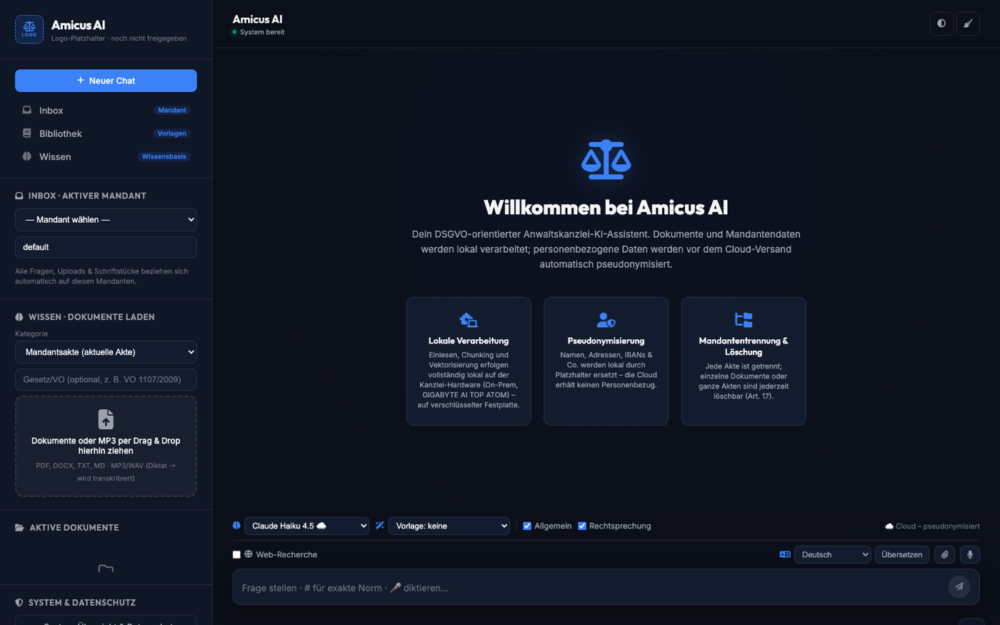
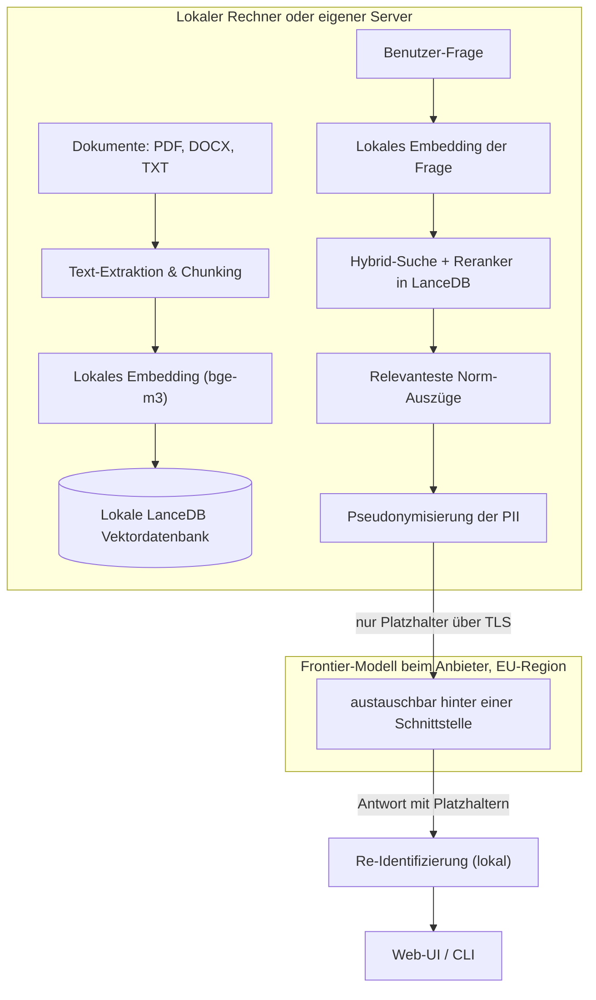

> **Archiviert seit 29.10.2026, nicht mehr betreiben.** Dieses Repository ist ein eingestellter
> Prototyp. Die Anmeldung vertraut dem Header `cf-access-authenticated-user-email`, ohne den
> Cloudflare-Access-JWT zu pruefen; ausserhalb von Cloudflare Access kann jeder diesen Header setzen.
> Code nicht deployen und nicht als Vorlage verwenden.
>
> **Archived since 29.10.2026, do not deploy.** A discontinued prototype whose login trusts the
> `cf-access-authenticated-user-email` header without verifying the Access JWT.

# Amicus AI

Ein Wissenssystem für Kanzleien, das Akten lokal einliest, vor jedem
Modellaufruf pseudonymisiert und jede Antwort mit ihrer Fundstelle belegt.



> **Was das hier ist.** Ein Schaufenster, kein Produkt und kein laufender
> Dienst. Der Code stammt aus einem Prototyp von 2026 und liegt öffentlich,
> weil die Architektur die interessante Aussage ist, nicht die Oberfläche. Es
> läuft nirgendwo, es nimmt keine Daten entgegen, und die Beispieldaten sind
> erfunden.

## Die Idee in drei Sätzen

Ein Sprachmodell kennt Ihre Akten nicht, und das soll auch so bleiben. Also
sucht das System zuerst in den eigenen Unterlagen, schickt nur die Abschnitte
weiter, die zur Frage gehören, und ersetzt vorher jeden Namen durch einen
Platzhalter. Was zurückkommt, wird lokal wieder aufgelöst und trägt die Stelle,
aus der es stammt.

## Was daran technisch zählt

- **Dreistufige Suche, rein lokal.** Einbettungen mit bge-m3, dazu eine
  Volltextsuche, und ein Cross-Encoder sortiert nach. Reine Vektorsuche findet
  Themen, aber keine Aktenzeichen und keine Paragrafen.
- **Pseudonymisierung vor dem Aufruf.** Namen, Orte und Organisationen über
  Named Entity Recognition, dazu Regeln für E-Mail, Telefon, IBAN und
  Steuernummer. Die Zuordnungstabelle bleibt lokal.
- **Mandantentrennung im Index.** Jeder Abschnitt trägt seine Akte; Suche,
  Statistik und Löschung filtern darauf. Eine Frage kann keine fremde Akte
  erreichen.
- **Löschung, die vier Orte erfasst.** Dokument, Index, Verlauf und Protokoll.
- **Protokoll im Haus.** Append-only, für Einlesen, Suche und Löschung.

Die Messung dazu steht in [docs/analyse-paragraphen.md](docs/analyse-paragraphen.md):
Warum ein einfaches RAG bei Gesetzestexten die falsche Norm nennt, und was
dieses System anders macht. Der Goldstandard ist die Verordnung (EG)
Nr. 1107/2009 mit ihren 84 Artikeln.

## Aufbau

```
app.py, main.py        Oberfläche im Browser und auf der Kommandozeile
rag_agent.py           Einlesen, Zerlegen, Einbetten, Vektordatenbank
retrieval.py           hybride Suche und Reranker
pseudonymizer.py       die Schleuse vor dem Modellaufruf
providers.py           Modelle austauschbar hinter einer Schnittstelle
research.py            Websuche, nur mit pseudonymisierter Anfrage
transcription.py       Diktate lokal zu Text
eval_rag.py            die Messung aus der Analyse
beispieldaten/         erfundene Akten und ein öffentlicher Gesetzestext
docs/                  Architektur, Analyse, Datenschutz, Maßnahmen
```


## Datenschutz

Die Maßnahmen und ihre Fundstellen stehen in [docs/dsgvo.md](docs/dsgvo.md),
die technischen und organisatorischen Maßnahmen in [docs/tom.md](docs/tom.md).
Kurz: lokale Pseudonymisierung nach Art. 4 Nr. 5, Trennung je Akte, Löschung
nach Art. 17, Protokoll nach Art. 5 Abs. 2, Zugriffsschutz auf jedem Endpunkt.

## Woher das kommt

Gebaut 2026 als Prototyp für eine Kanzlei, zuletzt am 03.07.2026. Die
Anforderungen kamen aus dem Alltag: eigenes Wissen wiederfinden, eine
Einschätzung, die an ihre Fundstelle gebunden bleibt, Diktate, Akten mit
mehreren tausend Seiten. Aus diesem Prototyp ist AMANA geworden.

Wie der Weg heute aussieht, steht im Blog:
[blog.leopardcode.ai](https://blog.leopardcode.ai/de/)

## Lizenz und Kontakt

Der Code liegt zur Ansicht hier, ohne Garantie und ohne Unterstützung.
LeopardCode.AI, Dr.-Ing. Alexander Brunker, contact@leopardcode.ai
