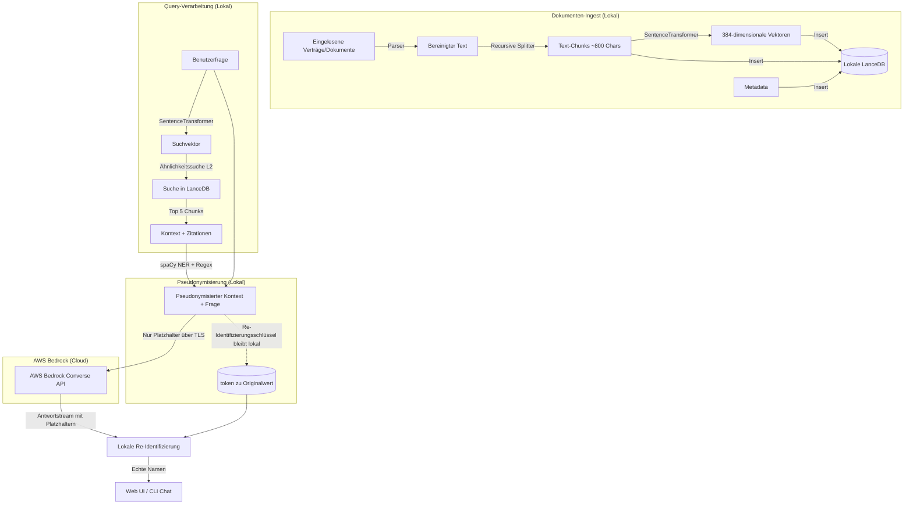

# Technische Dokumentation: Anwalt Agent RAG

Diese Dokumentation beschreibt die inneren Abläufe, die Systemarchitektur und die technischen Entscheidungen des **Anwalt Agent RAG** Systems. Sie dient als Leitfaden für Entwickler, die das System anpassen oder erweitern möchten.

---

## 1. Systemarchitektur & Datenfluss

Das System folgt dem Prinzip des **Hybrid-RAG (Lokale Vektorsuche + Cloud LLM)**. Das bedeutet, dass sensible Mandantendaten den lokalen Rechner niemals unstrukturiert verlassen. Nur hochgradig relevante Textauszüge werden an die Cloud übermittelt.



---

## 2. Kernkomponenten im Detail

### 2.1 Textextraktion & Chunking (`DocumentProcessor`)
*   **Extraktion**:
    *   **PDF**: Verwendet `pypdf.PdfReader` zur seitenweisen Extraktion. Dadurch bleibt die Seitennummer für Zitate erhalten.
    *   **Word (DOCX)**: Nutzt `docx.Document` zur Absatzextraktion.
    *   **Text/Markdown**: Wird als roher UTF-8 Text eingelesen.
*   **Chunking (Slicing)**:
    Die Textblöcke werden mit einem gleitenden Fenster (Sliding Window) verarbeitet:
    *   **Ziel-Chunkgröße**: 800 Zeichen (ca. 120–150 Wörter).
    *   **Überlappung (Overlap)**: 150 Zeichen. Dies stellt sicher, dass semantische Zusammenhänge an den Schnittstellen nicht verloren gehen.

### 2.2 Lokale Vektordatenbank (`LanceDB`)
*   **Warum LanceDB?**
    *   **Serverless**: Benötigt keinen Hintergrunddienst oder Docker-Container (wie pgvector oder Qdrant). Sie speichert Daten direkt in einem lokalen Ordner (`.lancedb_data/documents.lance`).
    *   **Column-Oriented**: Lance basiert auf dem Apache Arrow Format und ist dadurch extrem speichereffizient und schnell.
*   **Tabellen-Schema**:
    ```python
    schema = pa.schema([
        ("vector", pa.list_(pa.float32(), list_size=384)), # Vektor (all-MiniLM-L6-v2)
        ("text", pa.string()),                            # Roher Textabschnitt
        ("source", pa.string()),                          # Dateiname des Dokuments
        ("page", pa.int32()),                             # Seitenzahl (für Citations)
        ("chunk_id", pa.string())                         # Eindeutige UUID
    ])
    ```

### 2.3 Lokale Embeddings (`SentenceTransformers`)
*   **Modell**: `sentence-transformers/all-MiniLM-L6-v2`
*   **Details**:
    *   Das Modell läuft komplett lokal (auf der CPU oder der Apple Silicon GPU `mps`, falls verfügbar).
    *   Es wandelt den Text in einen dichten Vektor mit **384 Dimensionen** um.
    *   Es ist extrem leichtgewichtig (ca. 90 MB) und bietet ein hervorragendes Verhältnis von Geschwindigkeit zu semantischer Genauigkeit.
    *   Das Modell wird beim ersten Start automatisch von Hugging Face heruntergeladen und lokal im Cache des Nutzers gespeichert (`~/.cache/huggingface/hub/`).

### 2.4 AWS Bedrock Integration
Die Verbindung zu AWS Bedrock erfolgt über das Python-SDK `boto3`. 
*   **Unified Converse API**: Die API verwendet die moderne Methode `converse_stream()`. Dies vereinheitlicht die Payload-Strukturen über verschiedene Modellfamilien hinweg (z. B. Amazon Nova und Anthropic Claude).
*   **System Prompt & Halluzinationsschutz**:
    Um im rechtlichen Kontext falsche Antworten (Halluzinationen) zu minimieren, wird das Modell über einen strengen System-Prompt instruiert:
    > "You are a highly precise legal assistant... You MUST answer the query using ONLY the facts present in the context. If the answer cannot be inferred... state clearly that the information is not available..."

### 2.5 Lokale Pseudonymisierung (`pseudonymizer.py`)
Kernkomponente für die DSGVO-Konformität. Bevor Kontext und Frage an Bedrock gehen,
werden personenbezogene Daten **lokal** durch Platzhalter ersetzt; AWS erhält keinen
Personenbezug. Die Antwort wird lokal wieder zurückübersetzt.

*   **Erkennung (zweischichtig):**
    *   **spaCy NER** (`de_core_news_md`): Personen (`[[PERSON_n]]`), Orte (`[[ORT_n]]`),
        Organisationen (`[[ORG_n]]`). Optional – fehlt das Modell, läuft nur die Regex-Schicht.
    *   **Regex** (deterministisch, hat Vorrang vor NER): E-Mail, IBAN, Steuer-IdNr,
        Telefon, Datum, PLZ.
*   **Reversibilität:** Pro Vorgang konsistente Zuordnung `Wert -> Token` (gleicher Name =
    gleicher Platzhalter). Die Map ist der **Re-Identifizierungsschlüssel** und verlässt
    den Rechner nie.
*   **Überlappungsauflösung:** Treffer werden nach Priorität (strukturiert vor NER) und
    Länge dedupliziert, damit z. B. eine IBAN nicht von der Telefon-Erkennung zerschnitten wird.
*   **Streaming-fähige Re-Identifizierung:** `stream_reidentifier()` puffert angefangene
    Tokens über Chunk-Grenzen, sodass auch im Token-Stream korrekt zurückübersetzt wird.
*   **Bewusst nicht maskiert:** Geldbeträge und Langform-Datumsangaben (kein Personenbezug,
    aber juristisch relevant).
*   **Abschaltbar:** per `ANWALT_PSEUDONYMIZE=0` (nicht für Echtbetrieb empfohlen).

### 2.6 Mandantentrennung, Löschung & Audit (`rag_agent.py`)
*   **`matter_id`** in jedem Chunk; `search()`/`get_stats()` filtern darauf (`WHERE matter_id = ...`,
    Eingabe SQL-escaped). Verhindert Vermischung von Mandantendaten (Trennungsgebot).
*   **`delete_document()` / `delete_matter()`** für DSGVO Art. 17.
*   **`audit()`** schreibt ein Append-only JSONL (`audit_log.jsonl`) für Ingest/Suche/Löschung.

---

## 3. Web-API & Streaming (FastAPI)

Die Web-Anwendung teilt sich in ein FastAPI-Backend und ein klassisches Web-Frontend auf.

### 3.1 API Endpunkte
*   `GET /api/documents`: Holt Statistiken und eine Liste aller aktiven Dokumente aus der LanceDB.
*   `POST /api/ingest`: Empfängt Dateien über ein Multipart-Formular, speichert sie temporär, führt das Parsing und das Vektorisieren durch und löscht temporäre Dateien im Anschluss.
*   `POST /api/chat`: Verwendet eine `StreamingResponse` zur asynchronen Token-Ausgabe.
*   `POST /api/clear`: Löscht die LanceDB-Tabelle und setzt die Datenbank zurück.

### 3.2 Streaming-Protokoll (Custom SSE-Envelope)
Damit das Frontend die zitierten Dokumente kennt, bevor die Antwort generiert wird, schickt der `/api/chat`-Endpunkt als erste Zeile ein spezielles Metadaten-Paket:

```text
[METADATA]: {"type": "metadata", "citations": [{"index": 1, "source": "vertrag.pdf", "page": 3}]}

[Token 1][Token 2][Token 3] ... (Rest der Antwort als Stream)
```

Das JavaScript im Frontend fängt dieses `[METADATA]:` Paket ab, rendert die Zitate unter dem Eingabefeld und im Chat-Bubble und gibt danach die nachfolgenden Text-Token als flüssige Chat-Antwort aus.

---

## 4. Entwickler-Leitfaden: Erweiterungen

### 4.1 Neues Modell hinzufügen
Um ein neues Modell aus AWS Bedrock hinzuzufügen, trage einfach die entsprechende Modell-ID oder den Cross-Region Inference Profile ARN in das `MODELS`-Dictionary in `rag_agent.py` ein:

```python
MODELS = {
    "nova-lite": "eu.amazon.nova-lite-v1:0",
    "neues-modell": "eu.provider.modell-name-v1:0" # Neues Modell
}
```

### 4.2 Neuen Parser integrieren
Um ein weiteres Format (z. B. `.html` oder E-Mails `.eml`) zu unterstützen:
1.  Erweitere `DocumentProcessor.parse_file` um die entsprechende Dateiendung.
2.  Trage die Endung in `get_all_files` ein.
3.  Ergänze den Dateityp im `accept`-Attribut des File-Inputs in `static/index.html`.
